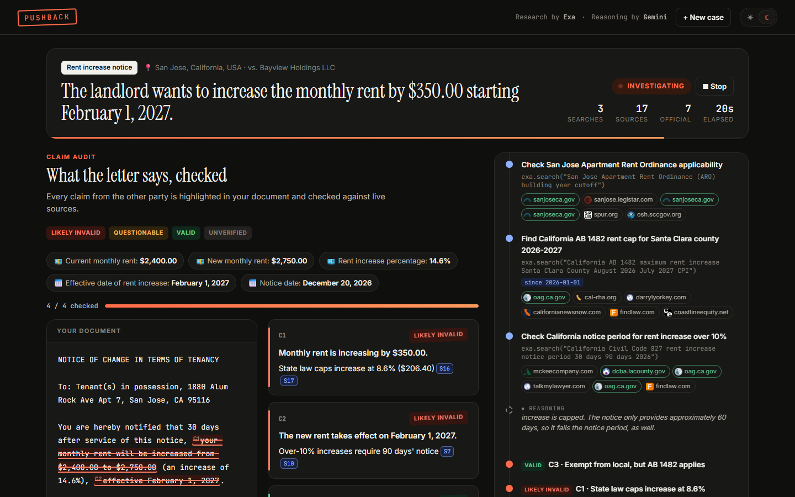
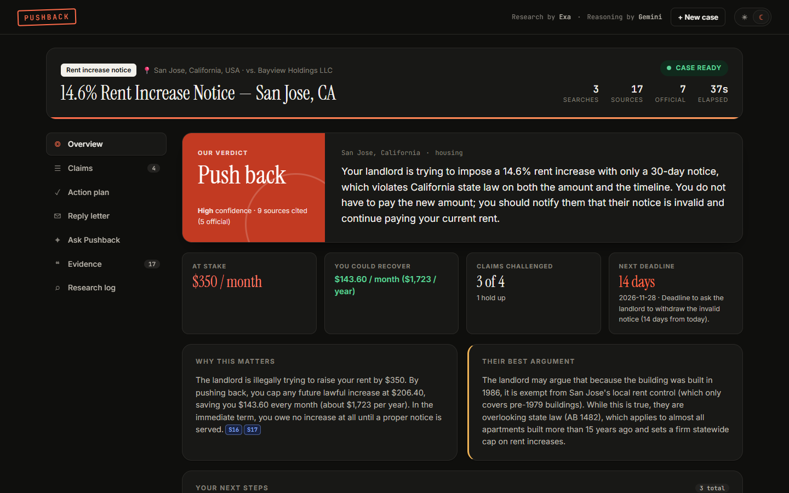
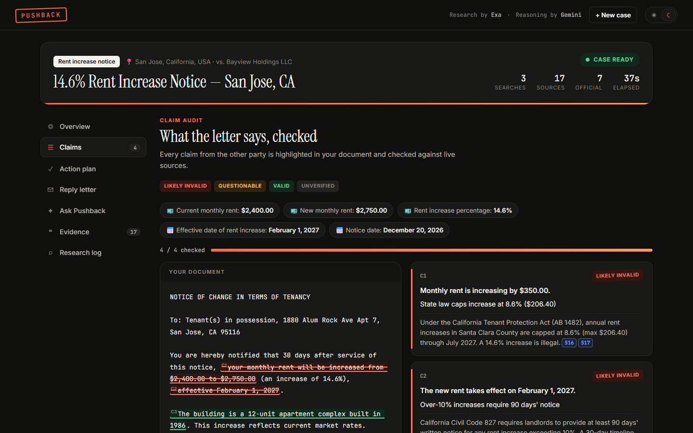
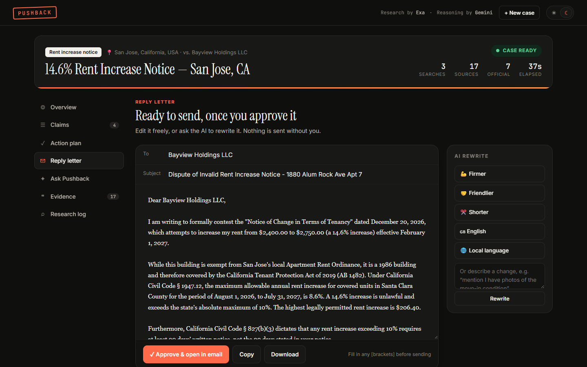

# PUSHBACK
### Your letter says one thing. The law might say another.

**Pushback is an AI advocate for unfair letters.** Paste (or photograph) a rent increase, a "no compensation" flight email, a surprise medical bill, a kept deposit or a withheld paycheck. Pushback checks **every claim in it** against the rules that apply **where you live, today**, shows the source behind every verdict, and hands you a ready-to-send reply. You approve it before anything is sent.

🎬 **Demo video (3 min):** [`demo/pushback-demo.mp4`](demo/pushback-demo.mp4)



---

## The problem
Landlords, airlines and billing departments send letters like these by the thousands, and they rely on people not checking. *"Compensation is not applicable." "Rent rises 14.6% in 30 days." "Balance due: $3,180."* The rules that let you push back exist, but they're spread across statutes, regulator pages, this year's caps and real cases. Checking takes hours, so most people just pay.

**Who it's for:** renters, travellers, patients and workers, especially people who can't afford a lawyer for a €400 problem.

## What it does
| | |
|---|---|
| ⚡ **Document X-ray in ~2 seconds** | Every claim the other party makes is highlighted in the original letter, along with key amounts and dates. |
| 🔎 **Live investigation** | Exa searches today's laws, government pages, recent news and real cases. You watch every search and source arrive. |
| 🟥 **Claim-by-claim verdicts** | Each claim is stamped *Likely invalid / Questionable / Valid / Unverified* as soon as it's verified, and illegal clauses are struck through in the letter. |
| ⚖️ **The verdict** | Push back, negotiate or comply, plus money at stake, what you could recover, your next deadline, and the other side's best argument. |
| ❝ **Proof for everything** | Every statement carries `S#` citations. Hover to see the exact quote; green marks official sources. Any citation the AI makes up is removed automatically. |
| ✅ **Game plan** | A checklist, a deadline timeline with one-click calendar export, and free local help (tenant unions, ombudsmen, legal aid). |
| ✉️ **Your reply, already written** | It quotes the exact law. One-click rewrites: firmer, friendlier, shorter, English, local language, or your own instruction. Nothing is sent until you approve. |
| 💬 **Ask anything** | Follow-up chat that researches live again when it needs new facts, with sources. |
| 📷 **Photo or PDF in** | Snap the paper letter and Gemini reads it directly. |
| 🌗 **Light and dark theme** | A clean light default with a matching dark theme. Works at phone width. |

| Verdict | Claim audit | Reply letter |
|---|---|---|
|  |  |  |

## How it uses Exa
Exa does the digging that a model's training data can't: **current** laws, **this year's** caps and amounts, **official** procedures and **local** help.
- **`/search` with `type: auto | fast | deep`.** Deep mode is used for hard-to-find facts.
- **`includeDomains`** targets official sources (e.g. `oag.ca.gov`, `kkv.fi`, `gov.uk`).
- **`startPublishedDate`** finds this year's rent caps, compensation amounts and recent rule changes.
- **`category: news`** checks for recent changes.
- **`contents.highlights` scoped to each query** means every source arrives with the exact passage that matters. That passage becomes the quote you see when you hover a citation.
- **`/contents` with `livecrawl`** reads the full, current text of the key statute or official guidance page.
- The agent runs several Exa searches **in parallel** each turn, typically 3–10 per case at about $0.02–0.03 of Exa credit. The cost is shown in the research log.

## How it maps to the judging criteria
| Criterion | Pushback |
|---|---|
| **Information beyond training data** | Every verdict rests on live Exa results: current caps, official pages and recent changes, filtered by date and domain. |
| **Useful to real people** | Renters, travellers, patients and workers facing unfair letters. The output is a sendable letter, deadlines and free local help, not just an answer. |
| **Clear sources** | `S#` citations everywhere, hover-to-quote, official badges, a full evidence locker and a live research log. Invented citations are stripped automatically. |
| **Originality** | An adversarial *claim audit*: it reads the other side's document and stamps each claim live, with the law highlighted inside the letter itself. |
| **Works on live queries** | Any letter, any country. Judges can paste their own. Off-topic requests get a polite "that's not what I do" in ~2s. |

## Try it
**Windows:** double-click **`run.bat`**. **macOS/Linux:** `./run.sh`. Both install dependencies, check your setup and open the browser.

Or manually:
```bash
pip install -r requirements.txt
copy .env.example .env      # add GEMINI_API_KEY (Google AI Studio) and EXA_API_KEY
python check_setup.py --online   # verifies Python, packages, keys (live), port
python main.py              # → http://localhost:8899
```
- **Try a real case:** click one of the six sample letters on the home page, then *Investigate*. A case takes about 45–75 seconds.
- **Offline backup:** http://localhost:8899/?replay replays saved real investigations without API calls. Useful if venue Wi-Fi fails.
- **Demo from a phone on the same Wi-Fi:** `HOST=0.0.0.0 python main.py`.

## How it works
```
Browser (static/) ──streams events──▶ main.py (FastAPI)
                                         │
                                agent.py ├─ 1. Triage: Gemini Flash-Lite reads the letter (~2s)
                                         │     → claims + exact quotes, amounts, dates; off-topic guard
                                         ├─ 2. Investigator: Gemini Pro + tools
                                         │     exa_search · exa_read_pages ──▶ exa_client.py ──▶ Exa API
                                         │     mark_claim (live verdict stamps) · submit_case_file
                                         ├─ 3. Safety: fill missing fields, strip invented citations
                                         └─ 4. Follow-up chat (can search again) · letter rewrites
```
Every Exa result gets a stable ID (`S1…Sn`) in a per-case registry, and the model can only cite those IDs. Gemini thought summaries stream live into the research log. On a rate limit it retries automatically, then falls back to a faster model.

## Robustness
- **Before anything is sent:** input checks (too short, wrong file type, files over 15 MB), and an off-topic guard that stops before spending research credits.
- **During a case:** a **Stop** button, a stall watchdog, a **Try again** card for every error, and friendly messages for rate limits and connection loss.
- **On the server:** inputs are size-capped and saved-run lookups are protected against path tricks. All AI output is validated before display.
- **Tests:** `python -m unittest discover -s tests -v` runs 14 offline tests (no keys needed) covering citations, the official-source check, case validation, the off-topic guard and every API endpoint.

## Project structure
```
main.py            web server + streaming endpoints, saved runs, replay
agent.py           prompts, tools, the investigation loop, chat, rewrites
exa_client.py      Exa search/contents, numbered source registry
static/            the app (HTML/CSS/JS, no build step) + sample cases
check_setup.py     preflight check (add --online to test keys live)
tests/             offline test suite
runs/              saved real investigations for offline replay
demo/              3-minute demo video
docs/screenshots/  screenshots used in this README
run.bat / run.sh   one-click start
```

## Limits
Pushback is **not a lawyer**, and it says so in every case file, pointing to free professional help for high-stakes situations. Answers depend on what Exa can find. Anything it couldn't verify is labelled *Unverified*, never guessed. Sessions are kept in memory, so restarting the server clears follow-up chat history.

*Sample letters use fictional companies; the laws they trigger are real.*
